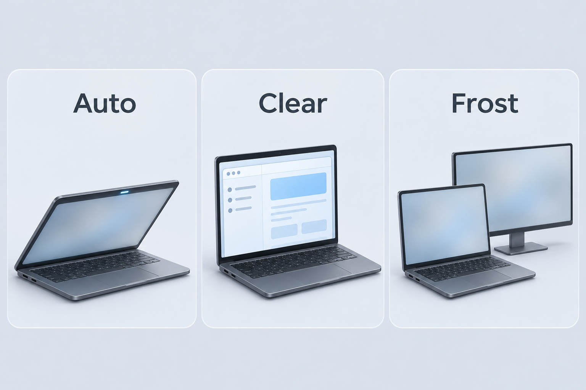

# FrostAwake

FrostAwake 是给 Apple 芯片 Mac 用的菜单栏工具。半合屏盖时自动磨砂并保活，也可以在菜单栏选 Clear 保持画面清晰，或选 Frost 给内外屏一起磨砂。

**复制给能操作这台 Mac 的 Agent**

> 请按 https://github.com/jin7933827109/FrostAwake 的 README 在这台 Mac 安装并打开 FrostAwake，确认「登录时启动」和 Auto Mode 已开启，macOS 要求授权时请引导我完成。



## 安装

需要 Apple 芯片 Mac、macOS 14 或以上及 Xcode Command Line Tools。如果尚未安装 Command Line Tools，运行 `xcode-select --install` 并完成系统安装。

```sh
git clone https://github.com/jin7933827109/FrostAwake.git
cd FrostAwake
bash install.sh
open "$HOME/Applications/FrostAwake.app"
```

安装脚本在本机构建并校验签名。已经安装过时，可直接打开现有 App 进行配置。首次启动后，确认「登录时启动 FrostAwake」和「启用 Auto Mode」已打开。保活需要用户在 macOS 的「系统设置 → 隐私与安全」中授权 FrostAwake，App 会提示授权位置。磨砂无需录屏权限。

## 菜单栏模式

| 模式 | 用法 |
| --- | --- |
| Auto Mode | 有兼容的铰链传感器时，半合盖触发磨砂和保活，抬过 60° 或合到 10° 以内时结束。 |
| Clear Mode | 保持画面清晰并保活，默认 5 小时，可选时长。 |
| Frost Mode | 内外屏一起磨砂并保活，默认 `⌘H` 开启、`H` 退出，可选 Touch ID 验证。 |
| Off | 停止保活和磨砂，App 保留在菜单栏。 |

灵动岛模式可从菜单栏开启，点击刘海左侧的状态区即可打开菜单。遇到需要立即停止的情况，可按 `⌃⌥⌘F`。磨砂用于遮挡旁观视线，设备访问控制由 macOS 锁屏提供。

菜单「导出运行状态」会将诊断写入本机 `~/Library/Application Support/FrostAwake/Diagnostics`。
